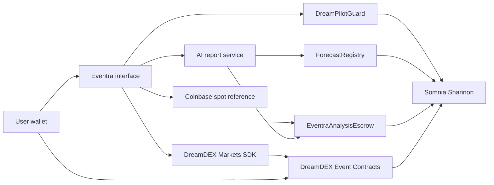

# Eventra — DoraHacks submission guide

## One-line pitch

Eventra turns raw DreamDEX Event Contract odds into an explainable AI decision, then lets the user execute and manage the position from their own wallet.

## Problem

Event Contracts expose prices and order books, but a consumer still has to decide which campaign has usable evidence, whether the chart and market odds agree, how much risk to take, and when not to trade. Switching between market data, AI tools and a wallet creates a fragmented experience.

## Solution

Eventra provides one controlled journey:

`Discover → Choose AI → Review fee → Analyze → Trade → Manage`

The report does not stop at an UP/DOWN label. It presents key indicators, market confirmation, confidence, invalidation conditions, execution constraints and a deeper model-specific narrative. Users remain in control of every wallet signature.

## Why DreamDEX is essential

Eventra uses DreamDEX for the Event Contract campaign, market state, odds, order-book liquidity, executable quote, trading and position exit. Coinbase supplies only an independent spot-price reference. Removing DreamDEX would remove the product's actual prediction market and execution layer.

## Why Somnia is essential

Somnia provides the wallet and execution network plus three Eventra contracts:

1. `DreamPilotGuard` — user-defined limits and signed advice acceptance.
2. `ForecastRegistry` — timestamped forecast commitments and scoring evidence.
3. `EventraAnalysisEscrow` — model-specific pay-on-success fees with a refund path.

## AI model marketplace

Users can choose Eventra Core, Grok, Surf, DeepSeek, ChatGPT or Claude. The product shows the analysis fee before generation. Eventra Core is the no-key demo baseline; external models unlock when their server APIs are configured. A failed paid report does not become a successful charge.

## Honest demo boundary

- `DreamDEX Live` is enabled only for a supported, unexpired and on-chain verified campaign.
- `Test Arena` exists for judge continuity when testnet liquidity or campaigns are unavailable.
- Simulated receipts are never labelled on-chain.
- A previous Somnia transaction may be shown as historical proof, but not represented as the current campaign.

## Architecture

## Deployed contracts

- DreamPilotGuard: `0xd2faBC3C9A096cEe10FC75e67f351E579B91EC38`
- ForecastRegistry: `0x3a88155FeA234FCda46cffD3B5a059DA4Fa52F7e`
- EventraAnalysisEscrow: `0xc4a0e9fB3f004392c22cA4d666f8756E9e99ec8C`
- Network: Somnia Shannon, chain ID `50312`

## Suggested DoraHacks description

Eventra is an AI execution copilot built around DreamDEX Event Contracts. It ranks open campaigns by evidence quality, lets users choose an AI analyst and see the fee before generation, produces an explainable UP/DOWN/WAIT report, and connects the decision to wallet-controlled DreamDEX execution. Eventra adds a Somnia-native safety guard, verifiable forecast registry and pay-on-success analysis escrow. When testnet campaigns are unavailable, a clearly labelled Test Arena preserves the judge demo without faking on-chain activity.

## Submission checklist

- [ ] Latest Eventra build is deployed at the submitted public URL.
- [ ] Public title and header both say Eventra.
- [ ] Mobile and desktop discovery flows are checked.
- [ ] Eventra Core produces a complete report without paid credentials.
- [ ] Test Arena completes report, simulated order and position exit.
- [ ] Live mode does not enable expired or unverified campaigns.
- [ ] Contract explorer links open correctly.
- [ ] Demo video follows `docs/DEMO_SCRIPT.md`.
- [ ] Repository and public demo URLs are added to DoraHacks.
- [ ] Screenshots show discovery, report, order ticket and receipt/position.
